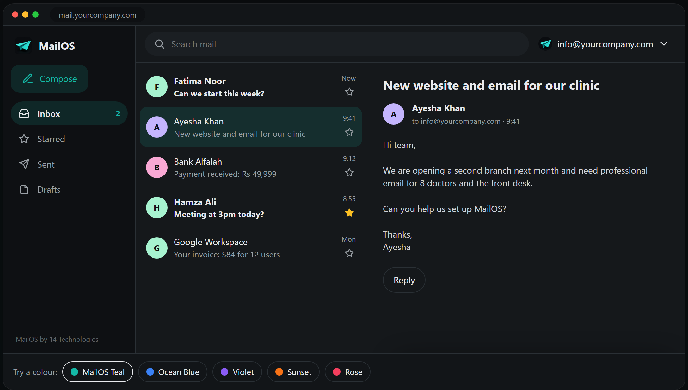

<p align="center"></p>

<h1 align="center">MailOS</h1>

<p align="center"><b>Free business email on your own domain.</b><br>
Mailboxes, calendar, booking page and file Drive for your whole team, running on your own Cloudflare account.<br>
Free and open source, by <a href="https://14technologies.com">14 Technologies</a>.</p>

<p align="center">
<a href="https://14technologies.github.io/mailos/"><b>Try the live demo</b></a> ·
<a href="#install-free">Install free</a> ·
<a href="https://14technologies.com/wp-content/themes/14technologies-theme/assets/docs/mailos-setup-guide.pdf">Setup guide (PDF)</a> ·
<a href="#support">Support</a>
</p>

<p align="center"><a href="https://deploy.workers.cloudflare.com/?url=https://github.com/14technologies/mailos"></a></p>

<p align="center"><a href="https://14technologies.github.io/mailos/"></a></p>

## Free means free

MailOS is free to install and use. No trial, no card, no per-user fee.

| What you get free | |
|---|---|
| Mailboxes on your domain | 10 (info@, sales@, you@ …) |
| Web app and phone app | Install from the browser on Android, iPhone and desktop, with instant notifications |
| Calendar | Events, invitations and reminders |
| Booking page | A public link where clients pick a free slot |
| Drive | 1 GB per person for files and sharing |
| Spam filter, rules, search | Included |
| Your data | Stays on your own Cloudflare account |

Sending and receiving cost nothing too: Cloudflare Email Routing receives mail free, and Resend's free tier sends 3,000 emails a month.

## Android app

<p><a href="https://github.com/14technologies/mailos/releases/latest"><b>⬇ Download MailOS for Android (latest APK)</b></a></p>

Version **1.0.5** · [direct link](https://github.com/14technologies/mailos/releases/download/android-v1.0.5/MailOS-Android-1.0.5.apk) · SHA-256 `d2fda641af822cc5ebb09c69ae467cd083ee07e3d9926118211cc56c533dc4c0`

1. Open the link on your Android phone and download the APK.
2. Tap the file. If Android asks, allow installing apps from your browser or Files app (**Install unknown apps**).
3. Open MailOS, enter your MailOS address (e.g. `https://mail.yourcompany.com`) once, and sign in.

Opens straight into your inbox, full screen, with background new-mail notifications, downloads to your Downloads folder, and the phone's back button closing menus and the composer first. The APK is sideloaded (not from Google Play yet), so Android shows its usual "unknown app" prompt; the SHA-256 above lets you check the file. Prefer no install? Open your MailOS address in Chrome and choose **Add to Home screen**.

## Install free

You need a domain (for example `yourcompany.com`) on a free Cloudflare account.

1. **Deploy.** Click **Deploy to Cloudflare** above. Keep the Worker name `mailos` (an internal name; changing it breaks mail routing).
2. **Create your admin.** Open the app at `/setup` and create your admin account.
3. **Connect your domain.** Add your domain, choose how to send (Resend free tier is easiest), then create your mailboxes.

> **`CF_TOKEN` is required.** Create a scoped Cloudflare API token and save it as the Worker secret `CF_TOKEN`:
>
> - All accounts: Email Sending:Edit, DNS Settings:Edit, Email Routing Addresses:Edit
> - All zones: DNS Settings:Edit, Email Routing Rules:Edit, Zone Settings:Edit, DNS:Edit

The illustrated [setup guide (PDF)](https://14technologies.com/wp-content/themes/14technologies-theme/assets/docs/mailos-setup-guide.pdf) walks through every screen. More options: [deployment guide](docs/deployment.md).

### Install with an AI agent

Paste this into an AI agent with terminal access (Codex, Cursor and similar):

```text
Install MailOS for me from https://github.com/14technologies/mailos on my Cloudflare account.

1. Read README.md, docs/deployment.md and wrangler.jsonc first.
2. Ask me for my Cloudflare account ID and two API tokens, using a secret input:
   a deploy token (for Wrangler) and a runtime token (the Worker secret CF_TOKEN).
   Never print them, commit them, or pass them as command arguments.
3. Keep the Worker name exactly "mailos". Create or reuse the D1 database
   "mailos", the R2 bucket "mailos-raw", and the queues "mailos-inbound",
   "mailos-outbound" and "mailos-agent".
4. Install dependencies, run `npm run deploy`, and set CF_TOKEN as a Worker secret.
   Do not run remote database migrations yourself. The /setup page does that.
5. Give me the app URL and anything I still need to do. I will open /setup, create
   the admin account and connect my domain.
```

### Self-host with Docker

Runs as one container on any server, with SQLite and local files.

```bash
cp .env.docker.example .env.docker
docker compose up -d --build
```

See [self-hosting](docs/self-hosting.md).

### Gmail, Outlook and Thunderbird

The optional [MailOS bridge](bridge/) adds POP3 and SMTP so desktop and phone mail apps can sign in. It runs on any small Linux server.

## Features

- **Email**: personal and shared mailboxes on your domain, conversations, instant search, snooze, follow-up reminders, read receipts, signatures and profile pictures.
- **Routing rules**: store, forward, reject or sort incoming mail.
- **Calendar**: repeating events with time zones; attendees get email invitations.
- **Booking**: a public link so anyone can book a free time on your calendar.
- **Drive**: store and share files.
- **Phone app**: installs from the browser, with push notifications.
- **Admin**: users, domains, API keys, webhooks, audit logs and backups.
- **Import**: bring in mail from IMAP, Gmail Takeout, `.eml` and `.mbox` files.
- **Flexible hosting**: Cloudflare Workers or Docker; D1, PostgreSQL, MySQL or Turso; R2, Backblaze B2 or AWS S3.
- **34 languages**, including اردو, हिन्दी, বাংলা, العربية and English.

## Optional upgrade

Most small teams never need one. If you grow past 10 mailboxes, **MailOS Pro** and **MailOS Team** add more mailboxes and logins, extra domains, more Drive space, the AI assistant, your own branding and priority help. A licence key unlocks them in **Admin → Upgrade**; nothing is reinstalled. Details at [14technologies.com/products/mailos](https://14technologies.com/products/mailos/).

## Support

- **Questions and bugs:** [GitHub Issues](https://github.com/14technologies/mailos/issues)
- **Setup help:** the [setup guide (PDF)](https://14technologies.com/wp-content/themes/14technologies-theme/assets/docs/mailos-setup-guide.pdf), or ask 14 Technologies to set it up with you at [14technologies.com](https://14technologies.com/products/mailos/)

## Local development

```bash
cp .dev.vars.example .dev.vars
npm install
npm run db:migrate:local
npm run dev
```

Add your Cloudflare credentials to `.dev.vars`, then open [localhost:3000](http://localhost:3000). Run `npm run db:seed` to load sample data. A schema change needs a migration for each database type; see [Databases](docs/databases.md#migrations).

## Documentation

- [Deployment and configuration](docs/deployment.md)
- [Databases](docs/databases.md)
- [Sending and receiving providers](docs/providers.md)
- [API and integrations](docs/api.md)
- [Email assistant and MCP](docs/email-assistant-and-mcp.md)
- [Adding a language](docs/localization.md)
- [Troubleshooting](docs/troubleshooting.md)

## Licence

MailOS is made by [14 Technologies](https://14technologies.com) and released as open source under the [GNU AGPL v3](LICENSE): you may use, change and share it, and if you run a changed version for others you must share your changes under the same licence. See [NOTICE](NOTICE).
